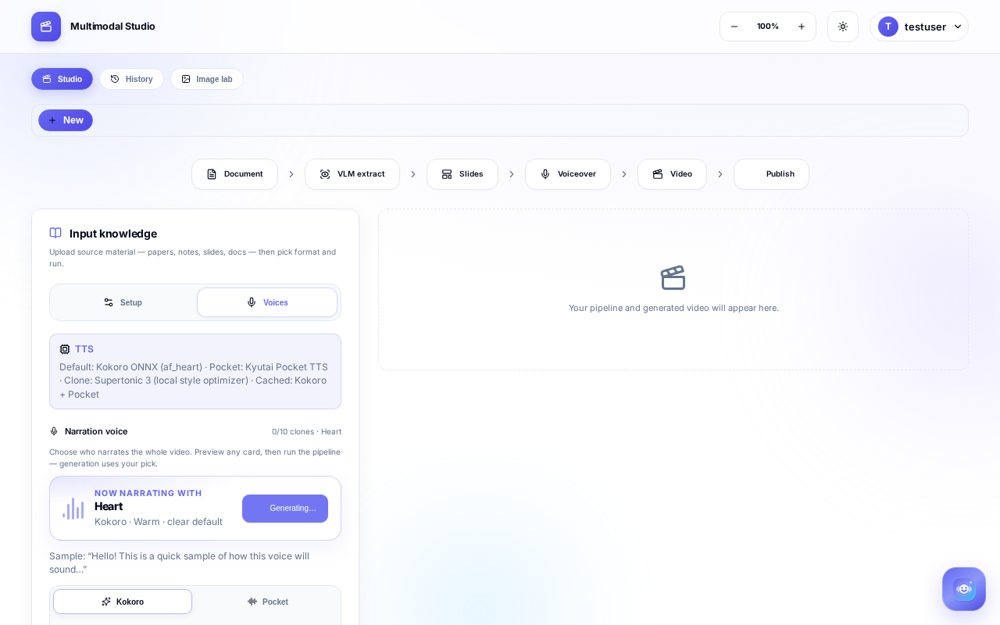
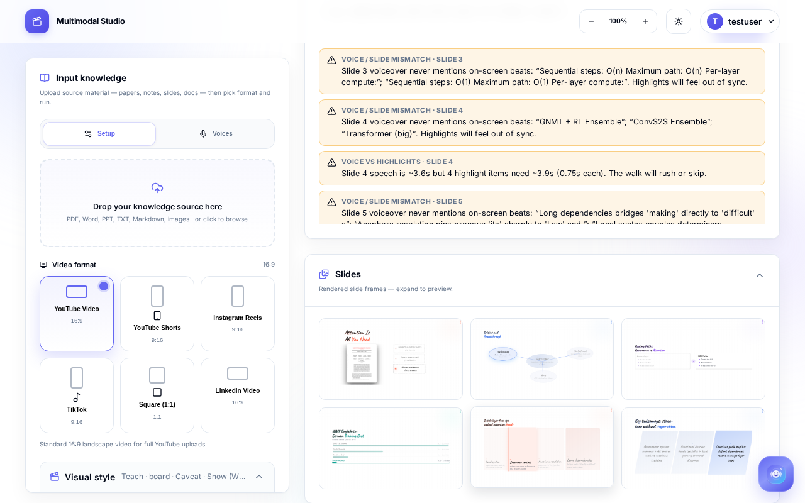
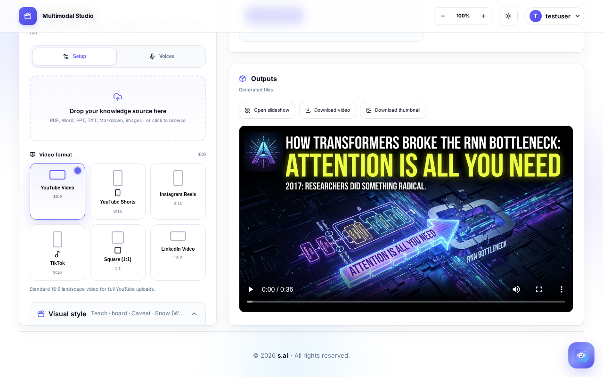
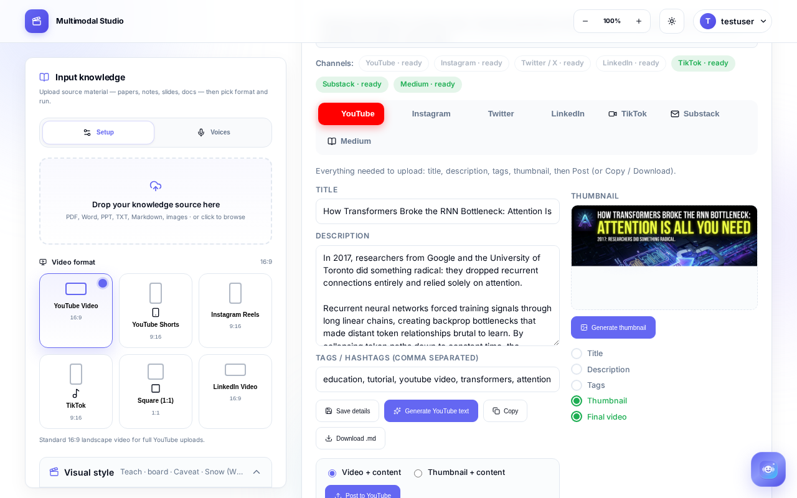
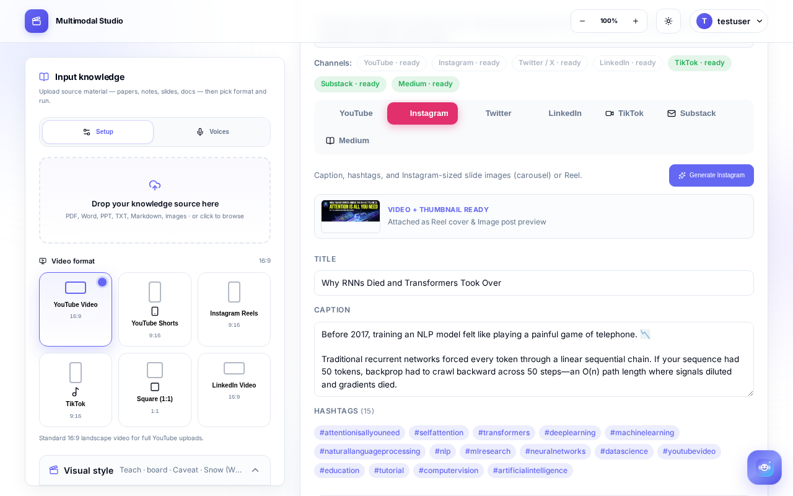
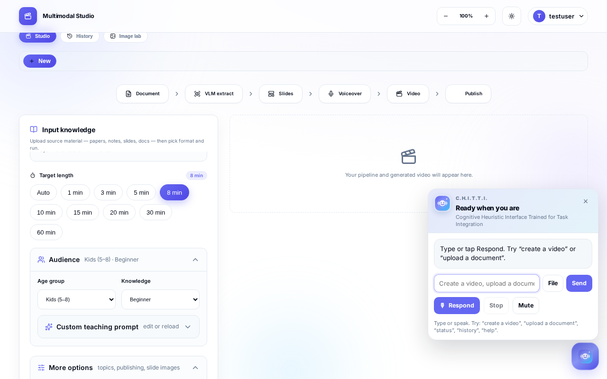
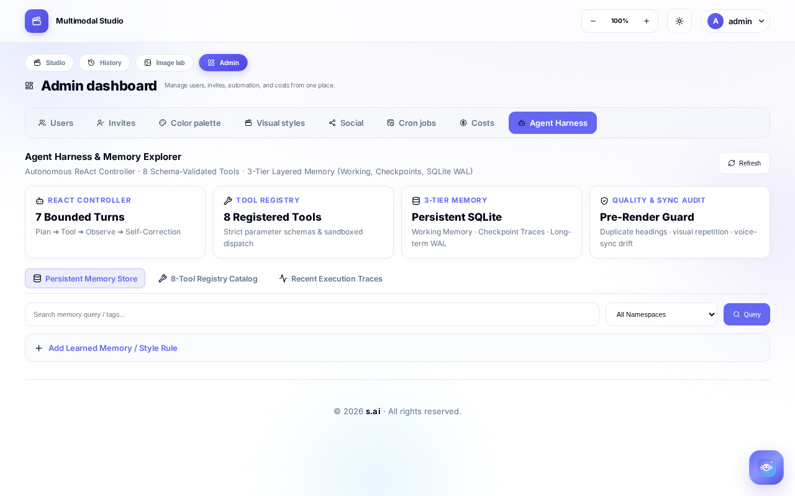
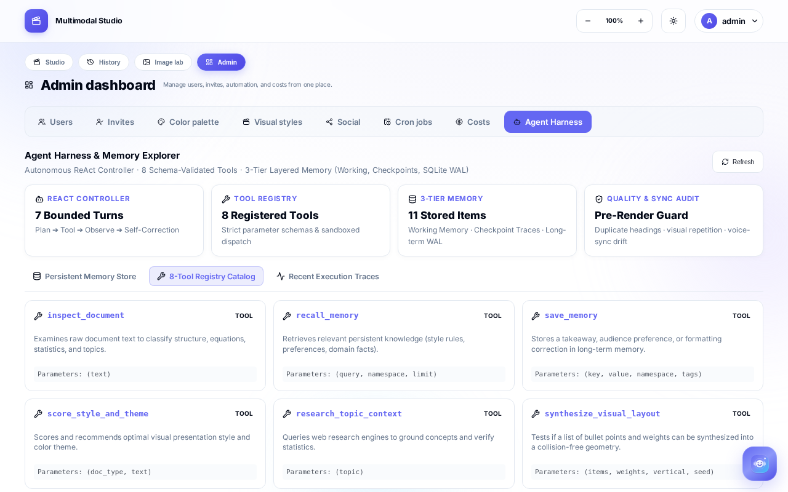
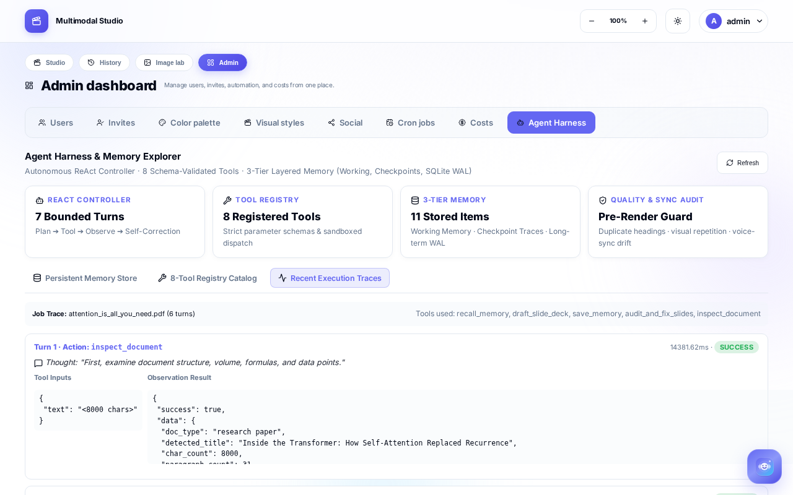

<p align="center">
  
</p>

<h1 align="center">Multimodal Studio</h1>

<p align="center">
  <strong>Turn any paper, document, notes, or slides into a narrated, animated, publish-ready MP4 video.</strong><br>
  ReAct Agentic AI Harness · 3-Tier Layered Memory · Data-Fit Slide Geometry · Kokoro &amp; Pocket Neural TTS · Playwright 2K Capture · 7-Channel Publish Packs
</p>

<p align="center">
  <a href="https://macharlasaiteja--multimodal-studio-web.us-east.modal.run"><strong>Live App (Modal)</strong></a> ·
  <a href="https://www.youtube.com/watch?v=vdoivUzZB2w"><strong>Video Demo (YouTube)</strong></a> ·
  <a href="https://github.com/saitej123/EAG-Capstone-Project"><strong>GitHub Repo</strong></a> ·
  <a href="#live-deployment--test-login">Test Login</a> ·
  <a href="#agentic-ai-architecture--flowchart">Architecture</a> ·
  <a href="#what-still-does-not-work">Known Limitations</a> ·
  <a href="#run-locally--configure">Run Locally</a>
</p>

<p align="center">
  
</p>

---

## Live Deployment & Test Login

| Item | Details |
| --- | --- |
| **Live URL (Modal Space: `macharlasaiteja`)** | [`https://macharlasaiteja--multimodal-studio-web.us-east.modal.run`](https://macharlasaiteja--multimodal-studio-web.us-east.modal.run) |
| **Modal Dashboard** | [`modal.com/apps/macharlasaiteja/main/deployed/multimodal-studio`](https://modal.com/apps/macharlasaiteja/main/deployed/multimodal-studio) |
| **Test Login (Standard User)** | Username / Email: `testuser` (`testuser@multimodalstudio.ai`) · Password: `testuser` |
| **Video Walkthrough (YouTube)** | [`https://www.youtube.com/watch?v=vdoivUzZB2w`](https://www.youtube.com/watch?v=vdoivUzZB2w) *(2m 04s Kokoro-narrated walkthrough &amp; live Attention Is All You Need run)* |
| **Direct MP4 Mirror** | [`/demo.mp4`](https://macharlasaiteja--multimodal-studio-web.us-east.modal.run/demo.mp4) · Repo copy: [`docs/demo/multimodal-studio-demo.mp4`](docs/demo/multimodal-studio-demo.mp4) |
| **GitHub Repository** | [`github.com/saitej123/EAG-Capstone-Project`](https://github.com/saitej123/EAG-Capstone-Project) · [`Commit history`](https://github.com/saitej123/EAG-Capstone-Project/commits/master) |

> **Cold-start note:** The Modal container scales down after 5 minutes of inactivity. The first request after idle takes ~15–25s while Kokoro &amp; Pocket TTS warm up.

---

## What the Project Does

**Dense research papers, reports, and slide decks take hours to read—and days to turn into compelling video content.** **Multimodal Studio** eliminates that bottleneck. Drop any document (such as a 15-page AI paper like *Attention Is All You Need*, a Word brief, a presentation, or Markdown notes), choose your destination platform, and walk away with a **studio-grade 2K animated video**, **neural voiceover**, **custom thumbnail**, and **7-channel social launch pack** in minutes.

### Why It Stands Out

- **Understands Pages, Equations & Diagrams:** Vision-first ingestion reads complex PDFs, mathematical notation, tables, and figures rather than dumping flat text—and can automatically split long books into web-researched video chapters.
- **Thinks Like a Creative Director:** An autonomous AI agent plans the narrative, recalls proven style and pacing rules across sessions, matches tone to your target audience (from beginners to domain experts), and audits its own draft to eliminate repetition or pacing drift before a single frame renders.
- **Every Slide Uniquely Engineered from Data:** No recycled card templates. Each slide's visual geometry—whether a proportional treemap, radial orbit, stepped cascade, timeline path, or weighted skyline—is synthesized directly from the slide's concepts and priorities.
- **Natural Voiceovers Locked to On-Screen Motion:** Built-in Kokoro and Pocket neural voices (plus custom voice cloning) narrate every beat, automatically paced to your chosen runtime while on-screen highlights animate in sync with the speaker.
- **Publish-Ready Across Every Channel:** Renders crisp 2K MP4 video, generates a high-contrast AI thumbnail, builds square Instagram carousels from your slides, and drafts tailored titles, posts, and long-form newsletters for **YouTube, Instagram, X, LinkedIn, TikTok, Substack, and Medium**—all alongside **C.H.I.T.T.I.**, a built-in voice assistant.

### Studio & Output Gallery

<table>
  <tr>
    <td width="50%">
      
      <br><sub><strong>Formats &amp; Visual Styles</strong> — YouTube 16:9, Shorts, Reels, TikTok, Square 1:1, LinkedIn across 174 unique style profiles.</sub>
    </td>
    <td width="50%">
      
      <br><sub><strong>Kokoro &amp; Pocket Voices</strong> — Preview built-in neural narrators or clone your own voice.</sub>
    </td>
  </tr>
  <tr>
    <td width="50%">
      
      <br><sub><strong>Content Review &amp; Slides Gallery</strong> — Duplicate &amp; voice-sync review plus all rendered frames for <em>Attention Is All You Need</em>.</sub>
    </td>
    <td width="50%">
      
      <br><sub><strong>Synced 2K MP4 Output</strong> — Embedded player and downloadable artifacts.</sub>
    </td>
  </tr>
  <tr>
    <td width="50%">
      
      <br><sub><strong>YouTube Publish &amp; Thumbnail</strong> — Auto-generated title, description, tags, and Nano Banana Pro thumbnail.</sub>
    </td>
    <td width="50%">
      
      <br><sub><strong>Instagram &amp; Social Packs</strong> — Reuses the generated thumbnail and turns slides into square carousels (also X, LinkedIn, TikTok, Substack, Medium).</sub>
    </td>
  </tr>
  <tr>
    <td width="50%">
      
      <br><sub><strong>C.H.I.T.T.I. Assistant</strong> — In-app Gemini Live voice &amp; command helper for creating videos and uploading docs.</sub>
    </td>
    <td width="50%">
      
      <br><sub><strong>History</strong> — Reopen, review, re-run, or delete any previous session.</sub>
    </td>
  </tr>
</table>

---

## What Still Does Not Work

- **TikTok, Substack, and Medium have no direct API auto-publish:** Studio generates tailored captions, hashtags, and Markdown articles for copy/download; direct API upload is only wired for YouTube, Instagram, X, and LinkedIn.
- **One-click social posting requires OAuth credentials:** On the hosted Modal instance (`youtube: false`), social posting stays disabled until OAuth tokens / `client_secrets.json` are configured in **Admin → Social** (and `PUBLIC_BASE_URL` is set for Instagram Graph API fetches).
- **Local Ollama &amp; CUA desktop automation are unavailable on Modal:** Headless Modal containers do not run a local Ollama server or desktop GUI, so cloud runs use `GEMINI_API_KEY` (or `OPENAI_API_KEY`) and exclude `cua` / `cua-agent`.
- **Local diffusion image models &amp; experimental in-slide AI images are disabled:** Thumbnails rely on cloud Gemini Nano Banana Pro (`gemini-3-pro-image`); `SLIDE_AI_IMAGES_DEFAULT=false`.
- **Hosted `testuser` is non-admin:** `testuser` can run the full Studio pipeline, preview/select Kokoro &amp; Pocket voices, generate thumbnails/carousels, browse History/Image Lab, and query `/api/jobs/{id}/agent-trace`, whereas Admin panels (`Users`, `Invites`, `Cron`, `Costs`, `Agent Harness` admin explorer) require an admin account.
- **Background paper cron scheduler is off in cloud web mode:** `AUTO_ENABLED=false` is set in `modal_app.py` so serverless web containers only execute on-demand user jobs.

---

## Agentic AI Architecture & Flowchart

Multimodal Studio wraps slide authoring inside an observable **Agentic AI Harness** (`app/pipeline/agent_harness.py`) backed by **3-Tier Layered Memory** (`app/agent_memory.py`) and an **8-Tool Registry**.


| Layer / Tool | Role |
| --- | --- |
| **Tier 1 · Working Memory** | Per-session goal, plan checklist (`[✓] inspect`, `[✓] recall`, `[✓] draft`), and scratchpad. |
| **Tier 2 · Checkpoint Memory** | Per-turn thought, tool args, latency, and result receipt saved to `agent_trace.jsonl`. |
| **Tier 3 · Long-Term Memory** | Persistent SQLite (`workspace/agent_memory.db`, WAL mode) for preferences, style rules, and feedback. |
| **`inspect_document` / `research_topic_context`** | Classifies document structure, equations, and stats; grounds topics via web search when enabled. |
| **`recall_memory` / `save_memory`** | Retrieves cross-session pacing/style rules and stores learned session takeaways. |
| **`score_style_and_theme` / `synthesize_visual_layout`** | Matches visual profile to document tone and verifies collision-free slide geometry. |
| **`draft_slide_deck` / `audit_and_fix_slides`** | Authors structured slide JSON, catches duplicate headings or sync drift, and auto-repairs before render. |

<table>
  <tr>
    <td width="50%">
      
      <br><sub><strong>Admin · Agent Harness &amp; Memory Explorer</strong> — Live SQLite memory search across namespaces.</sub>
    </td>
    <td width="50%">
      
      <br><sub><strong>Admin · 8-Tool Registry</strong> — Schema-validated tools with parameter typing and sandboxed dispatch.</sub>
    </td>
  </tr>
  <tr>
    <td width="50%">
      
      <br><sub><strong>Admin · ReAct Execution Trace</strong> — Step-by-step thoughts, inputs, observations, and timings.</sub>
    </td>
    <td width="50%">
      
      <br><sub><strong>Admin · Cost Tracker</strong> — Token &amp; spend breakdown across Gemini, OpenAI, and Live models.</sub>
    </td>
  </tr>
</table>

---

## Data-Fit Slide Layouts & Scenarios

Instead of cloning one card layout with different colors, `app/layout_engine.py` computes geometry from each slide's content (item count, sentence length, numeric values, and optional `weights`) so **no two slides in a deck share a geometry signature** and **no two of the 174 styles share the same `(lead family, motif, heading)` fingerprint**.

- **Scenario 1 — AI / ML Research Paper:** `inspect_document` flags LaTeX math and benchmarks; `recall_memory` applies `style_rules:ml_paper`; `draft_slide_deck` embeds KaTeX equations (`Attention(Q,K,V)`) alongside bullet takeaways.
- **Scenario 2 — Executive Brief (`weights`):** Pass `weights` (0–100) on a bullets slide so high-priority points take larger treemap/skyline area:

```json
{
  "heading": "Q3 Growth & Retention Drivers",
  "layout": "bullets",
  "weights": [100, 45, 30],
  "bullets": [
    "Enterprise net revenue retention reached 134%",
    "Self-serve customer acquisition cost dropped 22%",
    "Product-led onboarding reduced time-to-value to 4 days"
  ],
  "narration": "Our enterprise retention was the primary revenue engine this quarter, while self-serve acquisition efficiency gave us positive unit economics across all cohorts."
}
```

- **Scenario 3 — Engineering Runbook:** `steps` layouts route onto ordered `path`, `cascade`, or `bands` geometries with dwell-matched voice sync.

Verify locally:

```bash
.venv/bin/python scripts/check_layout_engine.py
```

---

## Run Locally & Configure

### Local (`Python 3.12` + `FFmpeg`)

```bash
cp -n .env.example .env          # set API keys + login credentials
bash scripts/setup_venv.sh       # uv venv + requirements.txt
source .venv/bin/activate
python run.py                    # http://127.0.0.1:8001
```

### Docker & Modal

```bash
docker compose up --build        # CPU container on :8001 (profiles: gpu, local-llm)
modal deploy modal_app.py        # serverless cloud deploy
```

### Key `.env` Settings (Never commit `.env`)

| Setting | Purpose |
| --- | --- |
| `AUTH_ADMIN_EMAIL` / `USERNAME` / `PASSWORD` | Bootstrap admin credentials (synced on startup) |
| `AUTH_DEMO_ENABLED` / `EMAIL` / `USERNAME` / `PASSWORD` | Optional non-admin test login (`testuser` / `testuser`) |
| `GEMINI_API_KEY` | Cloud LLM, VLM extraction, Nano Banana Pro thumbnails, Gemini Live |
| `LLM_PROVIDER` / `OLLAMA_BASE_URL` / `OPENAI_API_KEY` | `auto` · `gemini` · `ollama` · `openai` |
| `TTS_ENGINE` | `kokoro` · `pocket` · `supertonic` clones |
| `YOUTUBE_CLIENT_SECRETS` / `AUTO_ENABLED` | YouTube OAuth path and nightly cron paper scheduler |

### Project Structure

```
app/            FastAPI routes, orchestrator, agent_harness, agent_memory, layout_engine, pipeline
frontend/       Studio SPA, CHITTI live voice UI, Admin dashboard
pitch/          Interactive Capstone presentation
docs/           Screenshots and recorded walkthrough video
modal_app.py    Modal serverless deployment definition
scripts/        setup_venv.sh, check_layout_engine.py, e2e checks
.env.example    Environment template (secrets stay in .env)
```

---

<p align="center">
  <sub>Multimodal Studio · TSAI EAG Capstone</sub>
</p>
