<p align="center">
  
</p>

<h1 align="center">Multimodal Studio</h1>

<p align="center">
  <strong>Turn any paper, document, notes, or slides into a narrated, animated, publish-ready MP4 video.</strong><br>
  Powered by an autonomous ReAct Agentic AI Harness, 3-tier layered memory, data-fit slide geometry synthesis, Kokoro / Pocket neural TTS, Playwright 2K frame capture, FFmpeg assembly, and multi-platform social packs.
</p>

<p align="center">
  <a href="https://macharlasaiteja--multimodal-studio-web.us-east.modal.run"><strong>Live App (Modal)</strong></a> ·
  <a href="https://macharlasaiteja--multimodal-studio-web.us-east.modal.run/demo.mp4"><strong>Video Walkthrough (MP4)</strong></a> ·
  <a href="https://github.com/saitej123/EAG-Capstone-Project"><strong>GitHub Repo</strong></a> ·
  <a href="#test-login--live-deployment">Test Login</a> ·
  <a href="#what-still-does-not-work--known-limitations">Known Limitations</a> ·
  <a href="#agentic-ai-architecture--flowchart">Agentic AI &amp; Flowchart</a>
</p>

<p align="center">
  <a href="#how-to-use">How to use</a> ·
  <a href="#agent-harness-screenshots--dashboard">Harness UI</a> ·
  <a href="#real-world-scenarios--sample-artifacts">Scenarios &amp; Samples</a> ·
  <a href="#what-it-can-do">What it can do</a> ·
  <a href="#run-it">Run it</a> ·
  <a href="#configure">Configure</a> ·
  <a href="#how-a-slide-fits-its-content">Slide layouts</a>
</p>

---

## Test Login & Live Deployment

| Item | Details |
| --- | --- |
| **Live URL (Modal Space: `macharlasaiteja`)** | [`https://macharlasaiteja--multimodal-studio-web.us-east.modal.run`](https://macharlasaiteja--multimodal-studio-web.us-east.modal.run) |
| **Modal Dashboard** | [`modal.com/apps/macharlasaiteja/main/deployed/multimodal-studio`](https://modal.com/apps/macharlasaiteja/main/deployed/multimodal-studio) |
| **Test Login (Standard User)** | Username / Email: `testuser` (`testuser@multimodalstudio.ai`) · Password: `testuser` |
| **Video Walkthrough Recording** | [`https://macharlasaiteja--multimodal-studio-web.us-east.modal.run/demo.mp4`](https://macharlasaiteja--multimodal-studio-web.us-east.modal.run/demo.mp4) *(2m 04s Kokoro-narrated investor pitch &amp; live Attention Is All You Need walkthrough)* · Repo file: [`docs/demo/multimodal-studio-demo.mp4`](docs/demo/multimodal-studio-demo.mp4) |
| **Repository** | [`github.com/saitej123/EAG-Capstone-Project`](https://github.com/saitej123/EAG-Capstone-Project) |

> **Cold-start note:** The Modal container scales down after 5 minutes of inactivity. The first request after idle takes ~15–25s while Kokoro &amp; Pocket TTS warm up.

### Repository Commits (`master`)

| Commit | Message | Link |
| --- | --- | --- |
| `64022dd` | `harness addition` | [`64022dd`](https://github.com/saitej123/EAG-Capstone-Project/commit/64022ddbf22bb84fd76f95fca7974025ff817cf2) |
| `1479f21` | `new templates` | [`1479f21`](https://github.com/saitej123/EAG-Capstone-Project/commit/1479f21ed9dca0daa3a5bcc2bb49865320150f53) |
| `17d7705` | `slide fix` | [`17d7705`](https://github.com/saitej123/EAG-Capstone-Project/commit/17d77055fc39a9adeb9e4a02ee9d82660695444a) |
| `9885227` | `init` | [`9885227`](https://github.com/saitej123/EAG-Capstone-Project/commit/988522791479f4975ccadff889707092c2949d61) |

### What the Project Does

**Multimodal Studio** compiles raw knowledge (research PDFs like *Attention Is All You Need*, Word docs, PowerPoint decks, Markdown notes, or images) into synced, narrated videos:

1. **VLM + Text Ingestion:** Renders document pages and extracts structured concepts, equations, and benchmarks via Gemini Vision (or OpenAI / Ollama locally) with PyMuPDF fallback.
2. **Agentic AI Harness (`app/pipeline/agent_harness.py`):** Runs a bounded ReAct loop (`inspect_document` → `recall_memory` → `score_style_and_theme` → `draft_slide_deck` → `audit_and_fix_slides` → `save_memory`) backed by 3-tier SQLite/JSONL memory.
3. **Data-Fit Layout Engine (`app/layout_engine.py`):** Computes collision-free slide geometry per slide (treemap, orbit, cascade, masonry, path, golden split, bands, scatter, slices, skyline) sized from item count, text length, and importance `weights`.
4. **Kokoro &amp; Pocket Neural TTS (`app/pipeline/tts.py`):** Synthesizes per-slide voiceovers (Kokoro `af_heart` default, Kyutai Pocket TTS, or Supertonic voice clones) and fits audio pacing to target length.
5. **Deterministic 2K Capture &amp; FFmpeg Merge (`app/pipeline/capture_worker.py`, `media.py`):** Seek-captures CSS/SVG/KaTeX frame animations in headless Chromium synchronized to narration dwell, then merges synced H.264 MP4 output.
6. **Thumbnail &amp; Multi-Platform Publish Pack (`app/pipeline/thumbnail.py`, `social_post.py`):** Generates a Nano Banana Pro thumbnail (`gemini-3-pro-image`) and reuses that thumbnail + slide carousel across YouTube, Instagram, Twitter/X, LinkedIn, TikTok, Substack, and Medium.

---

## What Still Does Not Work / Known Limitations

- **TikTok, Substack, and Medium have no direct API auto-publish:** Studio generates tailored captions, hashtags, and full Markdown articles for copy/download, while direct API upload is only wired for YouTube, Instagram, X, and LinkedIn.
- **One-click social posting requires external OAuth credentials:** On the hosted Modal instance (`youtube: false`), social posting is disabled until platform OAuth tokens / `client_secrets.json` are configured in **Admin → Social** (and `PUBLIC_BASE_URL` is set for Instagram Graph API fetches).
- **Local Ollama &amp; CUA desktop automation are unavailable on Modal:** Headless Modal containers do not run a local Ollama server or desktop GUI, so cloud inference relies on `GEMINI_API_KEY` (or `OPENAI_API_KEY`) and skips `cua` / `cua-agent`.
- **Local diffusion image models &amp; experimental in-slide AI images are disabled:** Thumbnails use cloud Gemini Nano Banana Pro (`gemini-3-pro-image`); local diffusion weights are not installed and `SLIDE_AI_IMAGES_DEFAULT=false`.
- **Hosted `testuser` is non-admin:** `testuser` can run the full Studio pipeline, preview/select Kokoro &amp; Pocket voices, generate thumbnails/carousels, use History and Image Lab, and inspect job traces via `/api/jobs/{id}/agent-trace`, but Admin panels (`Users`, `Invites`, `Cron`, `Costs`, `Agent Harness` admin explorer) are restricted to admin accounts.
- **Background paper cron scheduler is off in cloud web mode:** `AUTO_ENABLED=false` is forced in `modal_app.py` so serverless web containers only execute on-demand user jobs.

<p align="center">
  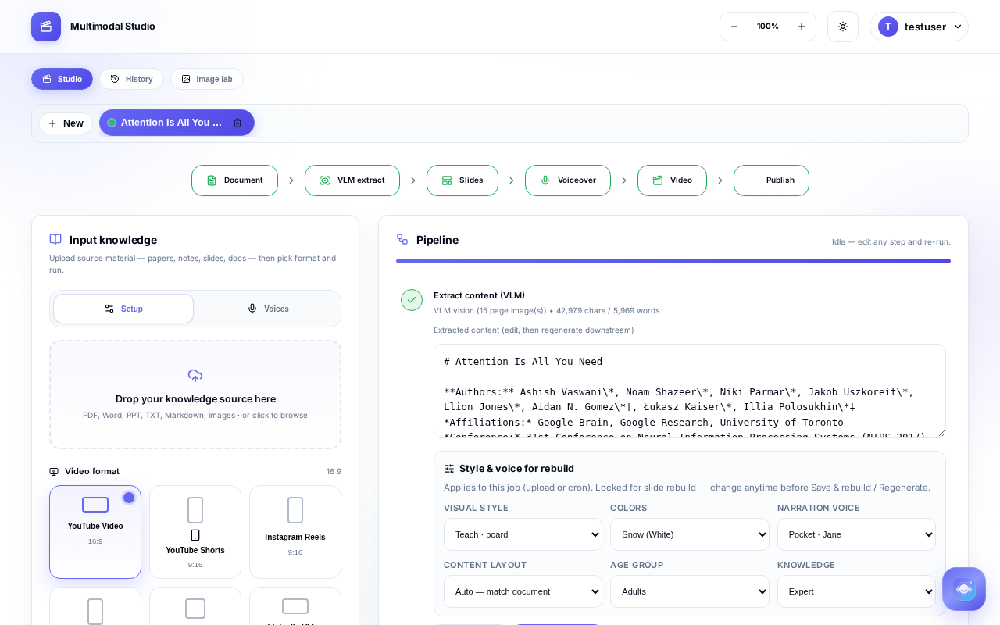
</p>
<p align="center"><sub>Studio after sign-in: <strong>Studio · History · Image lab · Admin</strong>. Drop a source, pick a format, run Document → Extract → Slides → Voiceover → Video → Publish.</sub></p>

---

## What it can do

<table>
  <tr>
    <td width="50%">
      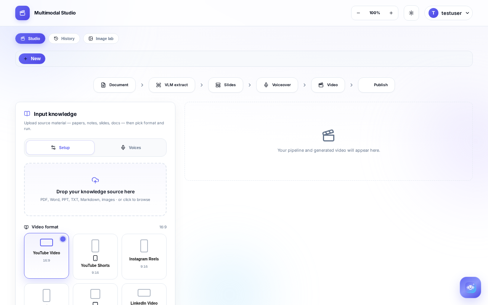
      <br><sub><strong>Six export formats</strong> — YouTube 16:9, Shorts, Reels, TikTok, Square 1:1, LinkedIn. Length chips follow the platform (8 min for long-form, seconds for Shorts).</sub>
    </td>
    <td width="50%">
      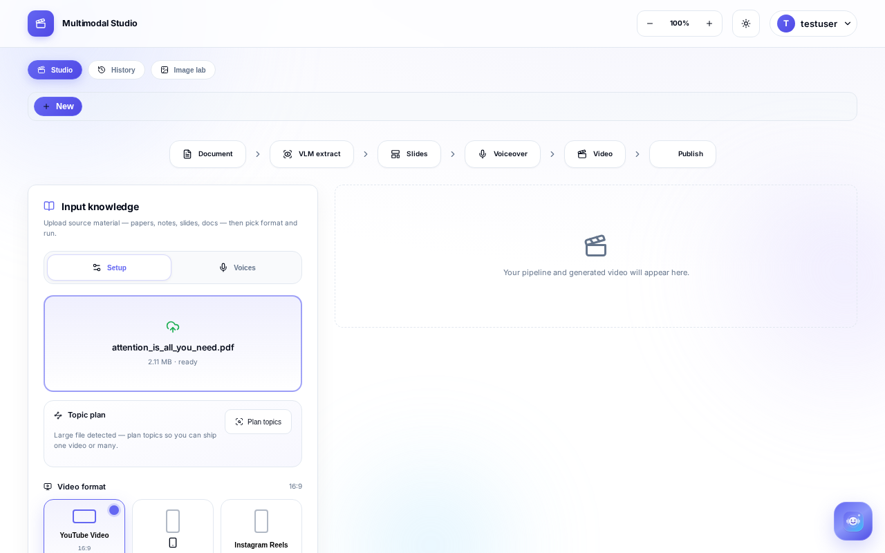
      <br><sub><strong>Visual styles</strong> — Teach, Motion, HyperFrames, Decks, Story, Data, Code. Auto picks layout + palette from the document.</sub>
    </td>
  </tr>
  <tr>
    <td>
      
      <br><sub><strong>Narration</strong> — Pocket and Kokoro catalog voices, plus record/upload clones. Preview before you run.</sub>
    </td>
    <td>
      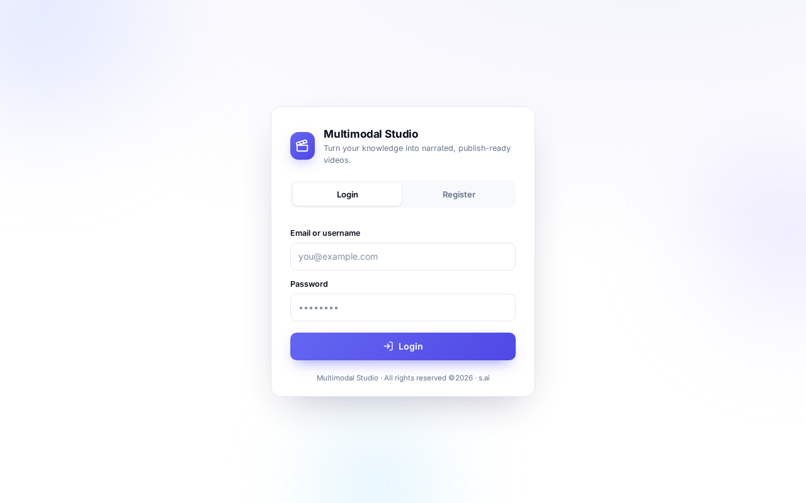
      <br><sub><strong>Invite-only access</strong> — sign in, or request an account an admin can approve.</sub>
    </td>
  </tr>
</table>

| Capability | What you get |
| --- | --- |
| **Ingest** | PDF, Word, PowerPoint, TXT, Markdown, images — VLM reads pages (Gemini / Ollama / OpenAI), with text fallback |
| **Teach to an audience** | Age group + knowledge level load a teaching prompt you can edit |
| **Plan long docs** | Split a book/paper into topics, research the web, then one video or many |
| **Review** | Duplicate-slide check and voice ↔ highlight sync before you ship |
| **Publish pack** | Titles, captions, tags, thumbnails for YouTube, Instagram, X, LinkedIn, TikTok, Substack, Medium |
| **Image lab** | Nano Banana Pro cloud thumbnails (Gemini). Local image models optional |
| **C.H.I.T.T.I.** | In-app voice assistant (Gemini Live) while you work |
| **Admin** | Users, invites, color palette, layout-family preview, social credentials, cron papers, costs |
| **History** | Every generated session — reopen, re-run, or delete (fills after you run the pipeline) |
| **Automation** | Admin cron: trending papers (HF / arXiv / Semantic Scholar) → overnight videos |

<p align="center">
  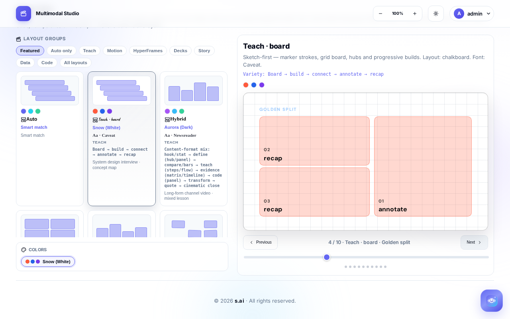
</p>
<p align="center"><sub>Admin (sign-in as admin): Users, Invites, Color palette, Visual styles (one frame per layout family), Social, Cron jobs, Costs.</sub></p>

<table>
  <tr>
    <td width="50%">
      
      <br><sub><strong>Content Review &amp; Slides Gallery</strong> — Automated duplicate &amp; voice-sync check alongside all 6 rendered slides for <em>Attention Is All You Need</em>.</sub>
    </td>
    <td width="50%">
      
      <br><sub><strong>YouTube Publish &amp; Thumbnail</strong> — Auto-generated title, description, tags, readiness checklist, and Nano Banana Pro thumbnail.</sub>
    </td>
  </tr>
  <tr>
    <td width="50%">
      
      <br><sub><strong>Instagram Carousel &amp; Cover</strong> — Reuses the generated thumbnail as cover preview and converts captured slides into square carousel images.</sub>
    </td>
    <td width="50%">
      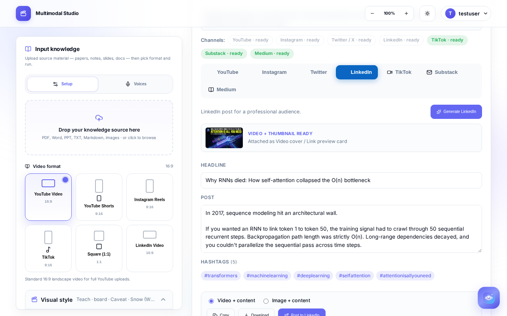
      <br><sub><strong>LinkedIn &amp; Multi-Platform Reuse</strong> — Attaches the same thumbnail and video across LinkedIn, Twitter/X, TikTok, Substack, and Medium.</sub>
    </td>
  </tr>
  <tr>
    <td width="50%">
      
      <br><sub><strong>C.H.I.T.T.I. Assistant</strong> — In-app voice &amp; command assistant for creating videos, attaching documents, and checking status.</sub>
    </td>
    <td width="50%">
      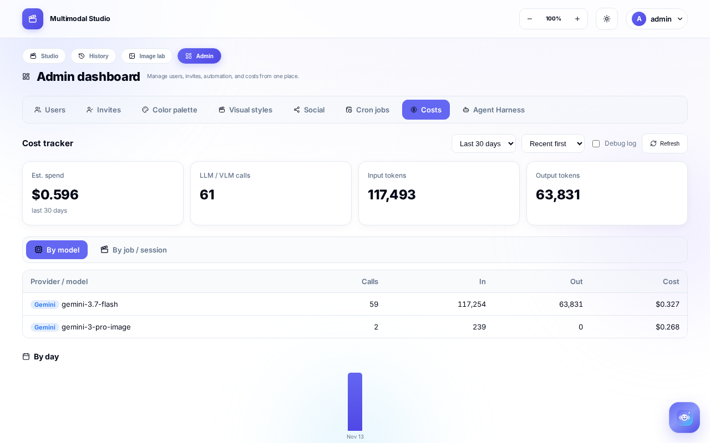
      <br><sub><strong>Admin Cost Tracker</strong> — Token &amp; dollar accounting across Gemini / OpenAI / Live models by model, job, and day.</sub>
    </td>
  </tr>
  <tr>
    <td width="50%">
      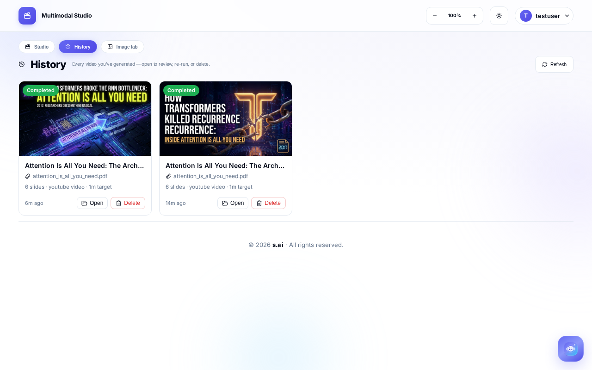
      <br><sub><strong>History</strong> — sessions appear here after a pipeline run. Open to review, re-run, or delete.</sub>
    </td>
    <td width="50%">
      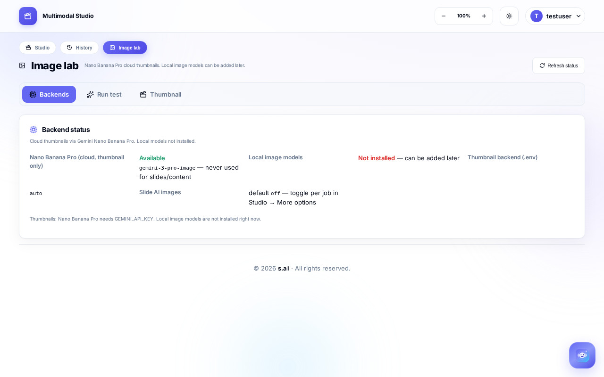
      <br><sub><strong>Image lab</strong> — Nano Banana Pro thumbnail backends and a prompt-based test generator.</sub>
    </td>
  </tr>
</table>

---

## Agentic AI Architecture & Flowchart

Multimodal Studio operates with a production **Agentic AI Harness** (`app/pipeline/agent_harness.py`) combining a bounded **ReAct Control Loop (Thought → Action → Observation → Self-Correction)**, an explicit **8-Tool Registry**, and a **Three-Tier Layered Memory Architecture** (`app/agent_memory.py`).

### System Flowchart

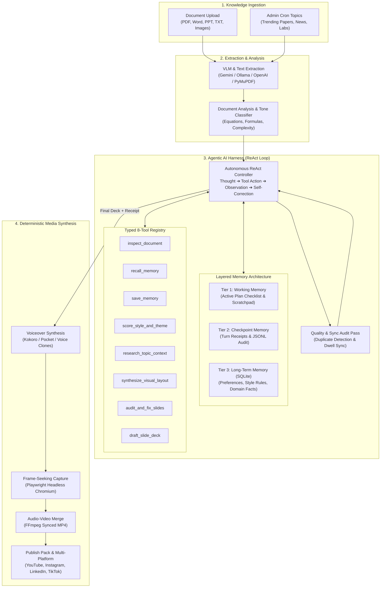

### Layered Memory & Tool Implementation

| Layer / Tool | Purpose & Engineering Standard |
| --- | --- |
| **Tier 1: Working Memory** | Ephemeral per-session state tracking the active goal, dynamic plan checklist (`[✓] inspect`, `[✓] recall`, `[✓] draft`), and observation buffer. |
| **Tier 2: Checkpoint Memory** | Episodic trace capturing every thought, tool name, argument payload, execution latency, and error state. Persisted to `agent_trace.jsonl`. |
| **Tier 3: Long-Term Memory** | SQLite database (`workspace/agent_memory.db`) with WAL mode storing persistent user preferences, document-to-style heuristics, and learned review feedback. |
| **Tool: `inspect_document`** | Deeply inspects document structure, volume, detected mathematical equations, and statistics. |
| **Tool: `recall_memory`** | Queries long-term memory via token and tag matching for audience rules and visual pacing. |
| **Tool: `save_memory`** | Persists run takeaways and user feedback into long-term memory for cross-session adaptation. |
| **Tool: `score_style_and_theme`** | Evaluates document tone against target audience to score layout styles and color palettes. |
| **Tool: `research_topic_context`** | Grounds concepts with live web research for verified facts and citations. |
| **Tool: `synthesize_visual_layout`** | Invokes `layout_engine` to compute data-fit cell coordinates and verify collision-free geometry. |
| **Tool: `audit_and_fix_slides`** | Deterministically reviews slides for duplicate headings, visual repetition, and voice-sync drift, triggering automated repair passes. |
| **Tool: `draft_slide_deck`** | Synthesizes structured slide deck JSON adhering to strict formatting constraints and word budgets. |

### Agent Harness Screenshots & Dashboard

<p align="center">
  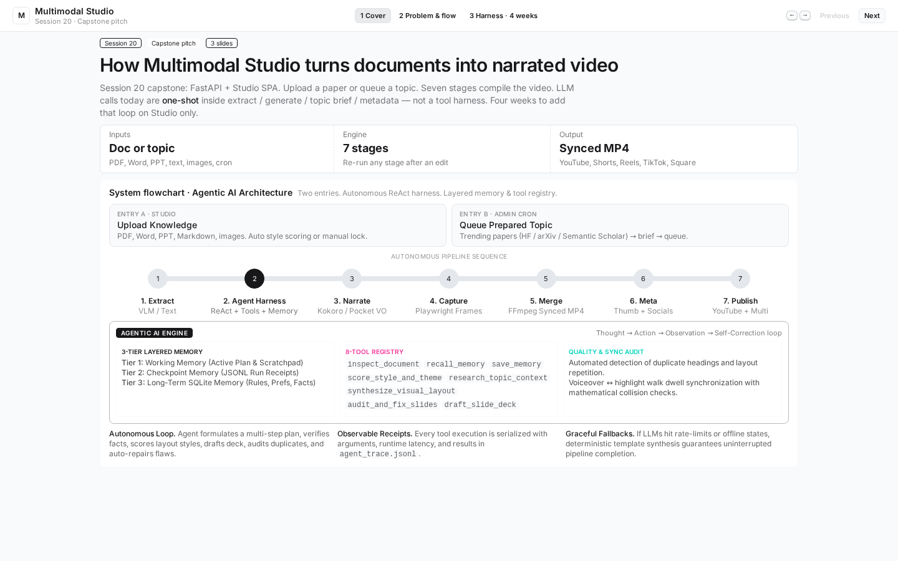
</p>
<p align="center"><sub><strong>Architecture Flowchart</strong> — Ingestion ➔ VLM Extract ➔ ReAct Agent Harness (3 Memory Tiers + 8 Tool Registry) ➔ Deterministic Media Synthesis (TTS, Playwright, FFmpeg).</sub></p>

<table>
  <tr>
    <td width="50%">
      
      <br><sub><strong>Agent Harness &amp; Memory Explorer</strong> — 4 architecture gauges, namespace filter, and live SQLite memory store with search.</sub>
    </td>
    <td width="50%">
      
      <br><sub><strong>8-Tool Registry</strong> — Schema-validated domain tools with parameter typing and sandboxed dispatch.</sub>
    </td>
  </tr>
  <tr>
    <td colspan="2">
      
      <br><sub><strong>Turn-by-Turn ReAct Trace</strong> — Inspects document, recalls persistent rules, scores styles, drafts slides, and executes automated self-repair.</sub>
    </td>
  </tr>
</table>

### Real-World Scenarios & Sample Artifacts

#### Scenario 1: AI & Machine Learning Research Paper (ArXiv / HuggingFace)
* **Input Knowledge:** Research PDF on Transformer architecture with attention equations, projection matrices ($W_q, W_k, W_v$), and BLEU score benchmarks.
* **Agent Harness Loop:**
  1. `inspect_document`: Flags academic paper with LaTeX equations and benchmark comparisons.
  2. `recall_memory`: Pulls `style_rules:ml_paper` guideline: *Highlight mathematical formulas, benchmark stats, and core architecture components.*
  3. `score_style_and_theme`: Recommends `teardown` style with `cyber` theme (dark glass, cyan accent, KaTeX formula formatting).
  4. `draft_slide_deck`: Generates multi-beat explainer with embedded LaTeX formulas:
     $$\text{Attention}(Q, K, V) = \text{softmax}\left(\frac{QK^T}{\sqrt{d_k}}\right)V$$
  5. `audit_and_fix_slides`: Validates KaTeX syntax and confirms no duplicate headings.
  6. `save_memory`: Records session takeaways and citation tags to persistent memory.

```json
{
  "heading": "Scaled Dot-Product Attention",
  "layout": "bullets",
  "equations": ["\\text{Attention}(Q, K, V) = \\text{softmax}\\left(\\frac{QK^T}{\\sqrt{d_k}}\\right)V"],
  "bullets": [
    "Queries and keys of dimension d_k are multiplied",
    "Softmax assigns weights to all value vectors",
    "Multi-head projection runs h attention layers in parallel"
  ],
  "narration": "Rather than calculating a single attention pass, queries, keys, and values are linearly projected into lower-dimensional spaces, allowing the model to attend to information at different representation subspaces simultaneously."
}
```

#### Scenario 2: Strategic Executive Brief & Financial Metrics
* **Input Knowledge:** Executive quarterly review with ARR numbers, churn reduction, and strategic priorities.
* **Agent Harness Loop:**
  1. `inspect_document`: Identifies business memo with critical percentages and currency values.
  2. `recall_memory`: Pulls `style_rules:executive_summary`: *Lead with key business metrics and high-level decision pillars.*
  3. `score_style_and_theme`: Selects `minimal` style with `editorial` palette and weighted layout geometry.
  4. `synthesize_visual_layout`: Evaluates `weights: [100, 45, 30]` and builds a squarified treemap where retention dominates the visual field.

```json
{
  "heading": "Q3 Growth & Retention Drivers",
  "layout": "bullets",
  "weights": [100, 45, 30],
  "bullets": [
    "Enterprise net revenue retention reached 134%",
    "Self-serve customer acquisition cost dropped 22%",
    "Product-led onboarding reduced time-to-value to 4 days"
  ],
  "narration": "Our enterprise retention was the primary revenue engine this quarter, while self-serve acquisition efficiency gave us positive unit economics across all cohorts."
}
```

#### Scenario 3: Systems Engineering & Cloud Migration Walkthrough
* **Input Knowledge:** Engineering runbook detailing containerized microservice migration to Kubernetes.
* **Agent Harness Loop:**
  1. `inspect_document`: Recognizes technical documentation with step-by-step sequential dependencies.
  2. `recall_memory`: Fetches `style_rules:how_to_tutorial`: *Use ordered milestones with clear step numbers and actionable instructions.*
  3. `score_style_and_theme`: Assigns `blueprint` style with `path` / `cascade` layout geometry.
  4. `audit_and_fix_slides`: Verifies voiceover dwell time so complex technical steps match narration pacing without speech rushing.

```json
{
  "heading": "Zero-Downtime Cluster Migration",
  "layout": "steps",
  "steps": [
    "Provision multi-region control planes",
    "Mirror database traffic with dual writes",
    "Deploy blue-green ingress routing",
    "Cut over DNS and decommission legacy VMs"
  ],
  "narration": "We begin by provisioning independent control planes, mirror real-time database transactions, switch ingress traffic through blue-green proxies, and finalize DNS cutover with zero downtime."
}
```

---

## How to use

1. **Sign in** at `http://127.0.0.1:8001` (bootstrap admin is set in `.env`). Admins see the **Admin** tab (users, visual styles, cron, costs).
2. **Studio → drop a file** (or click the dropzone). PDF / Word / PPT / notes / images all work.
3. **Pick a video format** (YouTube, Shorts, Reels, TikTok, Square, LinkedIn) and a **target length**.
4. **Visual style** — leave **Auto**, or pick a layout family (Teach, Motion, HyperFrames, …) and a color palette.
5. **Audience** — age + knowledge, or leave Auto. Edit the teaching prompt if you want a custom tone.
6. **Voices** — preview a Pocket / Kokoro voice, or clone yours from a recording.
7. **Run pipeline**. Watch the strip: Document → VLM extract → Slides → Voiceover → Video → Publish.
8. **Review** generated slides for duplicates and voice sync. Tweak extracted text or narration and re-run a stage if needed.
9. **Publish details** — generate per-platform copy, then Post (if credentials are set) or Copy / Download.
10. **History** — every finished (or in-progress) job lands here so you can reopen it later.

**Tip:** for long PDFs, use **Plan topics** first, pick the chapters you want, then run one combined video or one video per topic.

---

## Run it

### Local

Python 3.12, FFmpeg on `PATH` (or the bundled `imageio-ffmpeg` fallback).

```bash
cp -n .env.example .env          # then set keys + admin login
bash scripts/setup_venv.sh       # uv venv + requirements.txt
source .venv/bin/activate
python run.py                    # http://127.0.0.1:8001
```

Open the URL, sign in with `AUTH_ADMIN_EMAIL` / `AUTH_ADMIN_USERNAME` + `AUTH_ADMIN_PASSWORD`.

### Docker

```bash
cp -n .env.example .env
docker compose up --build        # http://127.0.0.1:8001
```

GPU thumbnail image: `docker compose --profile gpu up --build`  
Optional local LLM: `docker compose --profile local-llm up`

---

## Configure

Copy `.env.example` → `.env`. **Never commit `.env`.**

| Setting | Purpose |
| --- | --- |
| `AUTH_ADMIN_EMAIL` / `USERNAME` / `PASSWORD` | Bootstrap admin (required) |
| `GEMINI_API_KEY` | Cloud LLM, vision extract, Nano Banana thumbnails |
| `LLM_PROVIDER` | `auto` · `gemini` · `ollama` · `openai` |
| `OLLAMA_BASE_URL` / `OLLAMA_MODEL` | Local models (e.g. `gemma4:12b`) |
| `TTS_ENGINE` | Pocket / Kokoro / clones — Studio can override per run |
| `YOUTUBE_CLIENT_SECRETS` | Path to OAuth client JSON for YouTube upload |
| `AUTO_ENABLED` | Nightly paper → video scheduler (admin) |

Social posting tokens live in `workspace/social_credentials.json` (admin UI), not in git.

---

## How a slide fits its content

The same notes do not get a recoloured copy of one card stack. Each slide is laid out from its own items — how many there are, how long each line is, and an optional importance score — so the geometry changes with the data. The visual style you pick (Teach, Motion, Decks, …) chooses the first layout family, the background motif, and the heading treatment. Two styles never share that combination.

| What you drop in | What you see |
| --- | --- |
| Four short takeaways | A treemap, an orbit, a stair, or a pinned-note scatter — whichever that style leads with, and a different one on the next slide |
| One idea much more important than the rest | That line gets the large cell; the others shrink around it |
| Three numbers (`98%`, `120ms`, `12,000 docs`) | Bar height or tile area follows the number, not a fixed three-column template |
| Ordered steps | A path, a cascade, or stacked bands, so reading order stays obvious |
| A slide with narration and no bullets | Short phrases are pulled from the narration and laid out the same way |
| A quote, diagram, or before/after | Those keep their own frame; the fitter does not restyle them |

Give a bullets slide a `weights` list (0–100, one score per bullet) when you want size to follow importance instead of sentence length:

```json
{
  "heading": "What actually moved retention",
  "layout": "bullets",
  "weights": [100, 40, 25],
  "bullets": [
    "Weekly review cut churn in half",
    "Onboarding email helped a little",
    "A redesigned logo did not"
  ],
  "narration": "The weekly review mattered most. The email helped. The logo did not."
}
```

Families the fitter can draw: treemap, orbit, cascade, masonry, path, golden split, bands, scatter, slices, skyline. A deck will not repeat a geometry, and it will not use the same family on two slides in a row.

Check it locally:

```bash
.venv/bin/python scripts/check_layout_engine.py
```

---

## Layout

```
app/            FastAPI, pipeline, auth, automation
frontend/       Studio SPA
pitch/          Capstone deck
docker/         Container entrypoint
scripts/        setup_venv.sh, e2e
docs/screenshots/
.env.example    Template only — real secrets stay in .env
```

Runtime data is local and gitignored: `workspace/` (jobs + `sessions.db`), `models/` (TTS weights), `logs/`, `automation_output/`.

---

<p align="center">
  <sub>Multimodal Studio · TSAI EAG Capstone</sub>
</p>
